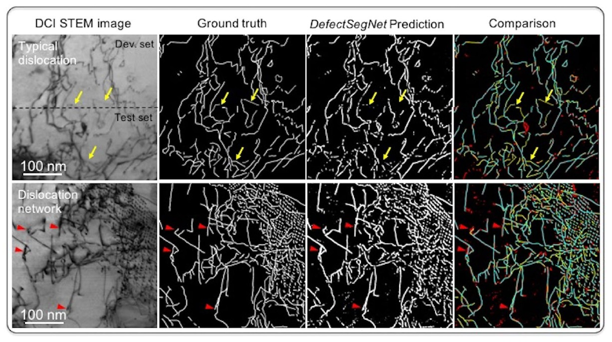
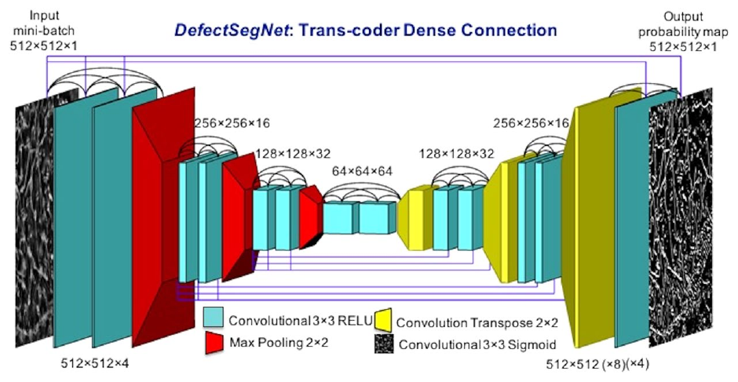

# DefectSegNet

Code and pretrained models for **DefectSegNet**, a CNN for semantic segmentation
of dislocations, precipitates and voids in DCI STEM images of steel.

[Paper](https://doi.org/10.1038/s41598-019-49105-0) | [Citation](#citation) | [Related: DefectTrack](https://github.com/rajatsainju2025/DefectTrack)

<p align="center">
  
</p>

Counting and sizing defects in electron micrographs is still mostly done by hand.
DefectSegNet automates the first step by labelling every pixel as defect or
background. It works on diffraction contrast imaging STEM (DCI STEM) images,
which show defects much more clearly than conventional TEM. Although it was
trained on a small set of images of neutron-irradiated HT-9 steel, it reaches a
pixel accuracy of 91.6% on dislocations, 93.4% on precipitates and 98.9% on
voids. Defect densities and sizes measured from its output were closer to the
ground truth than the average of six human experts.

*Above: dislocation segmentation on the dev/test split and on a dense
dislocation network. In the comparison column, turquoise marks true positives,
yellow false negatives and red false positives. Fig. 5 in the paper.*

## Model

DefectSegNet is an encoder-decoder network with 19 hidden layers. Each block is
densely connected, as in DenseNet. In addition, every encoder feature map is
passed to all decoder layers at the same resolution. These skip connections
within and across blocks are what set it apart from U-Net and FC-DenseNet. The
decoder upsamples with transposed convolutions, and a final 3 × 3 convolution
with a sigmoid gives a per-pixel probability map.

<p align="center">
  
</p>

*DefectSegNet architecture. Fig. 4 in the paper.*

## Getting started

The code uses the TensorFlow 1.x graph API (developed with TF 1.14), so use a
Python environment where TensorFlow 1.x is available.

```bash
git clone https://github.com/rajatsainju2025/DefectSegNet.git
cd DefectSegNet
pip install -r requirements.txt

python segmentation.py --image my_image.png --target void --output results/
python view_csv.py results/my_image_pred.csv --threshold 0.5
```

`--target` picks the pretrained model: `disloc` (dislocations), `prec`
(precipitates) or `void` (voids). The checkpoints are in
`best_checkpoint_<target>/`. `segmentation.py` writes the probability map as a
CSV file, and `view_csv.py` displays it, binarised at the given threshold.

## Imaging conditions

The models were trained only on DCI STEM images of HT-9 steel, so results on
other materials or imaging conditions may be worse. The training images were
acquired as follows:

- JEOL ARM200CF at 200 kV, convergence semi-angle 6.2 mrad, bright-field collection angle 9 mrad
- 250,000× magnification, 2048 × 2048 pixels, 16 µs dwell time
- Dislocations: systematic row condition, tilted from [001] to about 1g₀₁₁ on Bragg
- Precipitates and voids: tilted a further 2 to 4° until no diffraction is strongly excited

More detail is in the [DCI STEM paper](https://www.sciencedirect.com/science/article/pii/S0304399117305211).

## Citation

```bibtex
@article{roberts2019defectsegnet,
  title   = {Deep Learning for Semantic Segmentation of Defects in
             Advanced STEM Images of Steels},
  author  = {Roberts, Graham and Haile, Simon Y. and Sainju, Rajat and
             Edwards, Danny J. and Hutchinson, Brian and Zhu, Yuanyuan},
  journal = {Scientific Reports},
  volume  = {9},
  pages   = {12744},
  year    = {2019},
  doi     = {10.1038/s41598-019-49105-0}
}
```

## License

BSD 3-Clause; see [LICENSE](LICENSE). Figures are reproduced from the paper,
which is published open access under CC BY 4.0.

<details>
<summary>Disclaimer (Pacific Northwest National Laboratory)</summary>

This material was prepared as an account of work sponsored by an agency of the United States Government. Neither the United States Government nor the United States Department of Energy, nor Battelle, nor any of their employees, nor any jurisdiction or organization that has cooperated in the development of these materials, makes any warranty, express or implied, or assumes any legal liability or responsibility for the accuracy, completeness, or usefulness or any information, apparatus, product, software, or process disclosed, or represents that its use would not infringe privately owned rights.

Reference herein to any specific commercial product, process, or service by trade name, trademark, manufacturer, or otherwise does not necessarily constitute or imply its endorsement, recommendation, or favoring by the United States Government or any agency thereof, or Battelle Memorial Institute. The views and opinions of authors expressed herein do not necessarily state or reflect those of the United States Government or any agency thereof.

PACIFIC NORTHWEST NATIONAL LABORATORY
operated by BATTELLE
for the UNITED STATES DEPARTMENT OF ENERGY
under Contract DE-AC05-76RL01830

</details>
